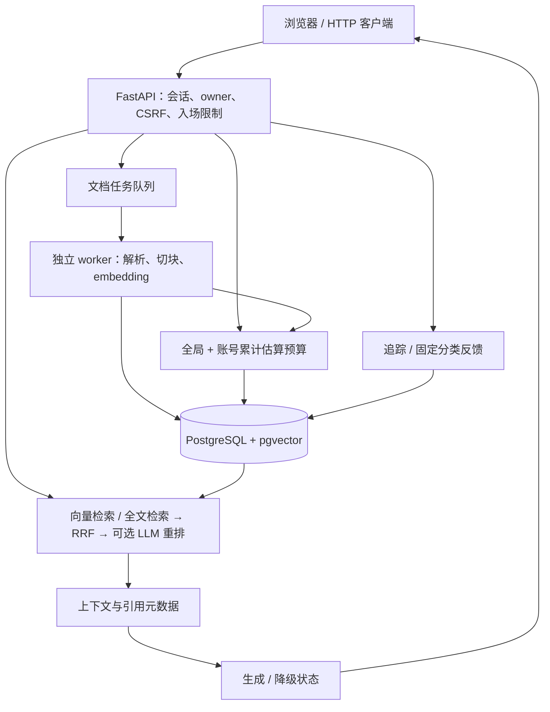

# 架构与边界

[返回 README](../README.md)

## 总体结构

API、worker 使用同一专用应用数据库和一致的模型、维度及预算配置。实际存储为 PostgreSQL/pgvector，没有 Qdrant 或 Agent 执行框架。

## 模块职责

| 路径 | 职责 |
| --- | --- |
| `app/main.py` | 应用装配、启动检查、隐私响应头、health/readiness |
| `app/auth.py`、`app/security.py` | 会话、口令、CSRF、库归属校验 |
| `app/routers/` | 文档、问答、预算、追踪、反馈接口 |
| `app/worker.py`、`app/services/ingestion.py` | 任务租约、版本发布、删除与并发冲突处理 |
| `app/services/extract.py`、`chunking.py`、`embeddings.py` | 文本/PDF 提取、token 切块和批量向量化 |
| `app/services/retrieval.py`、`search.py`、`reranking.py` | dense、全文检索、RRF 与重排编排 |
| `app/services/generation.py` | 基于上下文生成、引用与失败状态 |
| `app/services/budget_ledger.py`、`budget_policy.py` | 原子预占、价格/usage 校验、估算结算 |
| `app/services/tracing.py`、`feedback_cases.py` | 追踪白名单、正文同意、人工编辑导出 |
| `app/services/application_schema.py` | schema、迁移校验与恢复隔离检查 |
| `app/static/index.html` | 无构建步骤的浏览器界面 |

## 文档入库与版本

新文档走异步任务：接收 → queued → parsing → embedding → 原子发布 completed；异常进入 failed。相同字节可复用已有任务；失败任务可显式重试或丢弃 payload。

- 逻辑文献与不可变版本分离，检索只读取当前活跃版本。
- 更新失败保留旧版；基底版本过时拒绝发布，不能覆盖较新更新。
- 新异步 PDF 保留原文件及物理页定位，缺失的历史原件/页码标未知，不补造。
- 删除文献同时清除其版本、原文件、切块和关联任务，并保守清除该账号已有追踪正文；已经下载、发给供应商或进入备份的副本无法撤回。
- worker 默认串行，租约 900 秒、无自动续租，每轮最多领取 3 次。过期接管保证单任务至多一次数据库发布，**不保证外部模型恰好调用一次**。

## 检索与生成

问题 embedding → dense 检索；开启 hybrid 时另做 PostgreSQL 全文检索，再以 RRF 融合；可选 LLM 重排后截取上下文并执行置信度门禁。当前源码顺序执行检索，不宣称两个检索器并行。

默认重排使用 `baseline` 提示词与 `prefix_600` 截取方式；其他版本显式启用。生成候选实验不自动替换应用默认值。

`/query/evidence` 返回实际提供给生成阶段的上下文、生成状态和引用编号范围告警。生成失败仍可检查已经取得的证据；检索 embedding 本身被预算拒绝则返回失败，不伪装成空库。引用列表不等于模型已使用或语义支持答案；流式接口也不保证逐 token 交付。

## 身份、预算与恢复

- owner 来自服务端会话和 SQL 归属条件，不信任客户端提交的用户 ID。资源 ID 不能替代权限校验；变更请求还需 CSRF/同源检查。
- 模型调用前，在短事务中按固定锁顺序同时预占 global 与 account 额度；外部请求期间不持有预算行锁。每次重试独立预占。
- 合法 usage 按请求当时价格快照结算；缺失 usage、超时或结果不确定保留 held/unknown，无 TTL 自动退款。账本独立于 trace，删除追踪不改余额。
- API 与 worker 检查恢复隔离标记；恢复到新空库后撤销会话、冻结预算、暂停待处理任务，人工复核后才能放行。

这不是数据库管理员不可读的加密系统，也不是供应商实扣上限承诺。TLS、最小权限数据库角色、加密/轮换、HTTP 滥用防护和原件配额仍需部署方治理。维护命令见[部署与维护](OPERATIONS.md)。
